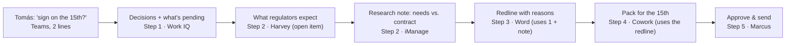

# Lab 654: Legal workflow

> Source: *654 Legal Lab scenario.docx* (SharePoint, owner: shisaha). Converted to Markdown for reference; formatting differs from the original, wording is preserved.
>
> Legal Copilot Lab, scenarios #1 and #4 | Fictional parties from Harvey LAB. Not legal advice.

## Scenario brief: talk track

### The setup

Meet Verdantis, a US insurance company that sells car and home insurance. To quote customers faster, it wants to use an AI platform from a tech company called Cognivault. The AI will help decide who gets a policy and at what price: up to 4 million decisions a month. It's a five-year, $14.75 million deal.

### Why this contract matters

When an AI helps set your insurance price, regulators care. Insurance regulators in states like Colorado and New York hold the insurer responsible, even when the AI belongs to a vendor. So Verdantis needs a contract that lets it check, explain and control the AI. And because Verdantis trains the AI on its own claims data, it wants to own what gets built.

### Where things stand

Nothing is signed. Cognivault sent its own standard contract, and it's written in Cognivault's favor (see [What's wrong with their draft](#whats-wrong-with-their-draft-the-short-version)). Verdantis has an internal playbook: its rulebook for what it will and won't accept in AI contracts. A negotiation session with Cognivault's lawyer is booked for the 15th.

### The people

Our user is Marcus, Verdantis's in-house tech lawyer; he owns this contract. Tomás runs underwriting, is the business owner, and wants the AI live by the 18th. Radhika runs procurement; two weeks ago she emailed Marcus the business's must-haves, and the three of them have been chatting in Teams since.

### Today

It's Monday morning. Tomás pings Marcus on Teams: "Can we sign on the 15th?" To answer, Marcus needs four things: what's already been decided, what the regulators expect, a redline of Cognivault's contract, and a plain-English answer for the business. Today that's days of digging through email, the document system, legal research and Word. Watch Copilot do it in five steps, with Marcus approving everything.

## At a glance

### Companies

| Company | Description |
|---|---|
| Verdantis | US car and home insurer (Stamford, CT). Our side: the customer buying the AI. |
| Cognivault | AI vendor (Austin, TX). Product: Cognivault Nexus, an AI underwriting platform. |

### People

| Person | Role |
|---|---|
| Marcus Hollowell | Associate General Counsel, Technology. The Copilot user. |
| Tomás Aguilar | Chief Underwriting Officer. Business owner; wants speed. |
| Radhika Sengupta | SVP, Procurement. Set the must-haves. |
| Priya Ramasubramanian | Cognivault's lawyer. Across the table on the 15th. |

### The contract

| Item | Detail |
|---|---|
| Document | Cognivault AI Vendor Agreement v4.2 + 4 exhibits (service levels, fees, security, acceptable use) |
| Status | Vendor's first draft. Not yet reviewed by Verdantis. |
| Value / term | $14.75M over 5 years ($2.95M a year) |
| Key dates | Today: Tomás's ask · 15th: negotiation · 18th: target go-live |

### What's wrong with their draft (the short version)

| Topic | Cognivault's draft says | Verdantis needs |
|---|---|---|
| Who owns the AI trained on our data | Cognivault | Verdantis |
| Changing the AI model | 15 days' notice, no say | 60 days' notice + our approval |
| Liability if things go wrong | ~$1.36M (6 months of fees) | $5.9M (2× annual value) |
| Regulator rights (audit, bias testing, cooperation) | Nothing | Required |

## #1 AI underwriting platform: Verdantis × Cognivault (detailed walkthrough)

**Driver:** Marcus Hollowell, Associate GC, Technology Transactions at Verdantis (US auto + homeowners insurer, Stamford CT).
**Vendor:** Cognivault Systems (Austin TX). $14.75M over 5 yrs ($2.95M/yr); the platform will make up to 4M underwriting decisions a month.

### Trigger (new Teams message, 2 lines)

From: Tomás Aguilar, Chief Underwriting Officer

> "Marcus, Cognivault sent over their contract (attached). We'd like to sign at the session with them on the 15th so we can go live on the 18th. Anything you need from me?"

### Seed data: to be added to tenant/users

- **Outlook, 2 weeks earlier:** Radhika Sengupta (SVP Procurement) to Marcus, cc Tomás: what the business needs from Cognivault, ranked, incl. "Colorado and New York examiners are scrutinising AI underwriting" (HLAB file).
- **Teams group chat, last week (add):**
  - Tomás: "Our last vendor retired its model on 2 weeks' notice and we couldn't quote for a week. Can't happen again."
  - Radhika: "Agreed. And we don't go to the table without owning the fine-tuned model."
  - Marcus: "Understood. I'll review Cognivault's paper against the playbook as soon as it lands."
- **iManage matter "Cognivault – Nexus":** vendor agreement + exhibits A–D; Verdantis AI Procurement Playbook (HLAB files).

### Flow

### Steps

| Step / surface | What Marcus types (plain English) | Pulls from | What comes back | Carries forward to… | Aha for the room |
|---|---|---|---|---|---|
| **1 Catch up** Copilot Chat *How Marcus gets here:* Reads Tomás's message; opens Copilot (Work mode). | "Can you help summarize the latest discussions and decisions we made with Radhika and Tomás about the Cognivault deal, and what's pending?" | Work IQ: Radhika's email (2 weeks old), the Teams group chat, Tomás's new message | **Decided:** we must own the fine-tuned model (Radhika, confirmed in Teams); no more short-notice model retirements (Tomás); Delaware law and courts, not the vendor's arbitration (Radhika). **Radhika's other asks:** control over model changes; explainability for Colorado and New York examiners; a clean exit; liability that matches the deal size. **Pending:** review Cognivault's contract against the playbook (Marcus); answer Tomás on signing the 15th, which Radhika's email says is a negotiation session with Cognivault's counsel, not a signing; what the Colorado and New York examiners will expect. Each point links to the email or chat it came from. | The open regulator question prompts Step 2. The decisions and Radhika's asks steer the redline (Step 3) and the business 1-pager (Step 4). | Tomás's message never mentioned model ownership or regulators. Copilot pulled the decisions from a two-week-old email and a Teams chat and listed what's still open. |
| **2 Check the law** Copilot Chat → @Harvey, then iManage *How Marcus gets here:* Same chat. Follows up on the open regulator item. | "@Harvey Colorado and New York regulators are looking hard at AI in underwriting. If we use Cognivault's model for our auto and homeowners policies, what will they expect from us, and what do we need from the vendor to show it?" Then: "Does the Cognivault agreement in our iManage matter give us those rights? Short table, and save it to the matter as a research note." | Harvey agent (US insurance regulation, with sources); iManage connector (reads the agreement, saves the note) | **Harvey, with citations:** Colorado's insurer AI rule (Reg. 10-1-1) now covers private auto but not homeowners, and requires bias testing and model documentation. NY DFS Circular Letter 7: the insurer stays responsible for vendor AI, so the contract should give audit rights and make the vendor cooperate with regulator inquiries. Each point has a link to the source. **Copilot's table:** Cognivault's draft gives no audit right, no bias testing, no regulator cooperation, only 15 days' notice of model changes, and nothing on explainability. Also flagged: our own playbook has no regulator-cooperation clause. The note keeps Harvey's source links. | The research note (now in iManage) is pointed to in the redline prompt (Step 3) and supplies the "why" in the 1-pager (Step 4). The playbook gap becomes a task for the knowledge team (Step 4). | Plain-English question in; specific rules and sources out. It even found a protection the department's own playbook misses. |
| **3 Redline** Word → Legal Agent *How Marcus gets here:* Clicks the agreement in Copilot's answer; it opens from iManage in Word. Opens Copilot pane → Legal Agent. | "Redline this version against our AI procurement playbook. What matters most to the business is owning the fine-tuned model and getting real notice before model changes, and we need the regulator rights from my research note. Explain each change in a comment so I can walk Cognivault's counsel through it." | Word Legal Agent; playbook + research note from iManage (picked with "/") | Tracked changes, each with a comment: We own the fine-tuned model and its outputs (playbook "hard stop") · no training other customers' models on our data without opt-in · 60 days' notice and our sign-off for material model changes; retired models kept 12 months (Tomás's worry) · yearly audit + quarterly bias testing · NEW: vendor cooperates with regulator inquiries · cap raised from 6 months' fees (~$1.36M) to 2× annual value ($5.9M) · 180-day exit, data back in CSV within 30 days. | The tracked changes and comments are the raw material for Step 4. The redline is the input; nothing gets re-typed. | Every comment says why: "playbook hard stop", "Radhika priority 1", or "needed to show NY regulators vendor oversight (research note)". Tomás's Teams message became a contract clause. |
| **4 Get ready for the 15th** Copilot Cowork (opened from Word) *How Marcus gets here:* Finishes the markup; opens Cowork from the same Copilot pane in Word. | "I've finished my redline of the Cognivault agreement. Get me ready for the 15th: save it to the matter, turn my changes into a negotiation list with our fallback for each, write a one-page plain-English version for Tomás and Radhika, draft my reply to Tomás, and draft the cover email to Cognivault's counsel." | Cowork + Work IQ (the thread with Tomás and Radhika) + iManage plugin (redline, research note, playbook fallbacks, save) + Harvey plugin (is the cap market?) | Cowork shows its plan, then produces: **Negotiation list:** one row per tracked change (their draft · our ask · playbook fallback · "do not concede" items marked). **1-pager:** "Yes to the 15th if Cognivault moves on 3 points" (model ownership, change control, regulator access), in dollars and plain English. The regulator points keep the source links from the research note. Reply to Tomás attaching the 1-pager · cover email to Cognivault's counsel attaching the redline · note to the knowledge team: add a regulator-cooperation clause to the playbook. | Everything lands in Cowork's review list for Step 5. Cowork asks before sending any email, so nothing has gone out yet. | One request turns a finished redline into five follow-ups across Word, Outlook, Teams and iManage. |
| **5 Review & send** Cowork review list → Word / Outlook *How Marcus gets here:* Cowork pauses: "5 items ready for your review." Marcus clicks each one. | No new prompt. In Cowork's review list, Marcus: Opens the 1-pager (it opens in Word) and edits as needed. Checks the two regulator statements in that 1-pager. Each carries the source link Harvey gave in Step 2 (passed through the research note); one click opens the NY DFS circular or the Colorado rule. Approves the reply to Tomás and the cover email to Cognivault's counsel; Cowork sends both from his Outlook. | Purview audit log; sensitivity labels; iManage audit trail | Tomás has a clear answer the same morning. Cognivault's counsel gets a reasoned redline before the 15th. Every file is in the iManage matter. | Close of the loop. Optional encore: after the 15th, ask Copilot "what did we concede?" to update the negotiation list. | Approval is built into the agent; the lawyer stays accountable. |

## Appendix

Use cases: *2025-generative-ai-in-professional-services-report-tr5433489-rgb.pdf* (images in the original document are not reproduced here).

## Data source mapping (added for the mock environment)

This section isn't part of the original document. It records where each piece of seed data lives in this repo. The seed content comes from the legal seed kit ([seed_kit.md](seed_kit.md)), which takes precedence over this document where they differ.

| Seed data | Where it lives | Notes |
|---|---|---|
| Radhika's business-priorities email (Sep 28) | `infra/mock_environment/Connectors_Ignite_EMP/emails.config.json` | Tenant (COEP) |
| Teams group chat "Cognivault deal" (Oct 6) | `infra/mock_environment/Connectors_Ignite_EMP/chats.config.json` | Tenant (COEP) |
| Tomás's trigger Teams message (Oct 12, 8:07 AM) | `infra/mock_environment/Connectors_Ignite_EMP/chats.config.json` | Tenant (COEP). No attachment: the contract lives only in iManage. |
| iManage matter "Cognivault – Nexus AI Platform Agreement" (agreement, Exhibits A–D, playbook) | `infra/mock_environment/mock_mcp_servers/imanage/seed_files/` | Connector, not tenant |
| Harvey regulatory research | `infra/mock_environment/mock_mcp_servers/harvey/` | Connector. No seed files; answers from public law. |
| Negotiation session on the 15th | None | The kit says no calendar item is needed. |
