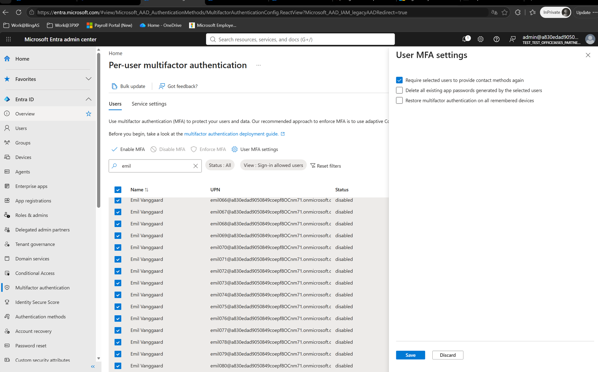

# Between lab runs: reset MFA for the lab accounts

Do this as an admin after every lab run, before the next one starts.

## Why this is needed

Each attendee registers an authenticator for their `emilNNN` account on the lab VM. The lab VMs are destroyed after the session, along with that authenticator. On the next sign-in, the account asks for a code from the authenticator that no longer exists, and the attendee is locked out.

Asking the users to register their contact methods again clears the saved MFA device from every lab account. The next attendee can then set up MFA from scratch.

## Admin sign-in

Sign in as the tenant admin. The admin credentials are on the tenant page in the SEVAL portal:

- [Connectors_Ignite_EMP_WW_2, version 1.0](https://seval.microsoft.com/tenant/detail/Connectors_Ignite_EMP_WW_2/1.0)

Do not copy the credentials into this repository.

## Steps

1. Go to [entra.microsoft.com](https://entra.microsoft.com) and sign in as the admin.
2. In the left rail, under **Entra ID**, select **Multifactor authentication**. This opens **Per-user multifactor authentication**.
3. In the search box, filter for `emil`.
4. Keep scrolling down until `emil114` is listed, so every lab account is loaded.
5. Select all the listed accounts with the checkbox in the column header.
6. Select **User MFA settings**.
7. Check **Require selected users to provide contact methods again**.
8. Select **Save**.

