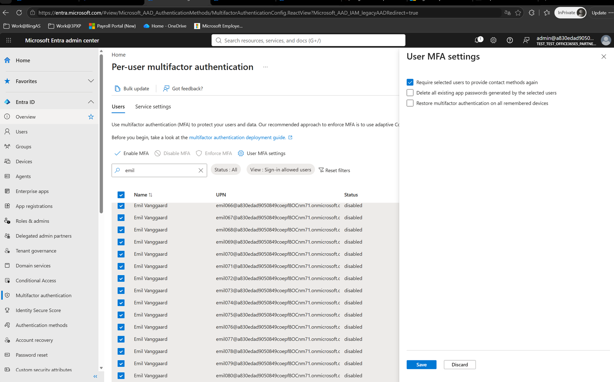
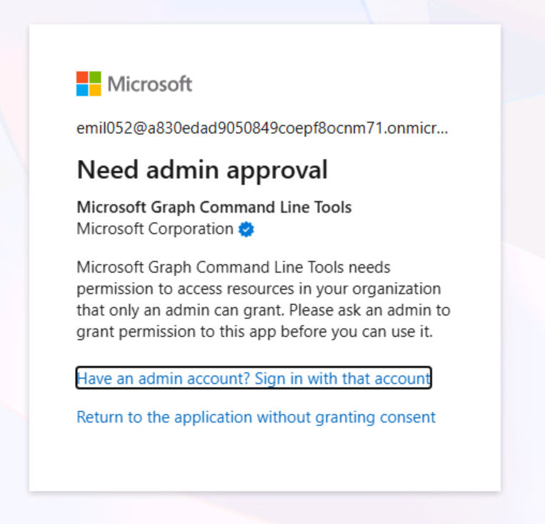
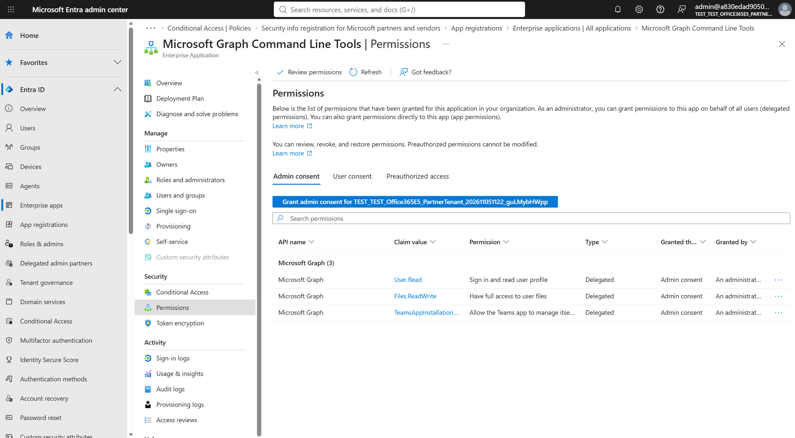
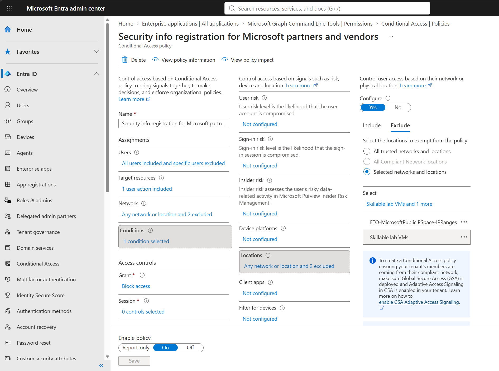

# Lab tenant troubleshooting

Issues we've hit with the lab tenant and the Skillable lab VMs, and how a tenant admin fixes each one.

| Issue | When to act |
|:---|:---|
| [Lab accounts ask for a code from an authenticator that no longer exists](#1-reset-mfa-for-the-lab-accounts) | After every lab run |
| [The reset script shows Need admin approval](#2-the-reset-script-shows-need-admin-approval) | Once per tenant, and again if the script's permissions change |
| [Sign-in or MFA registration is blocked with error 53003](#3-sign-in-or-mfa-registration-is-blocked-with-error-53003) | When a new Skillable IP range appears |

## Admin sign-in

Every fix below needs the tenant admin. The admin credentials are on the tenant page in the SEVAL portal:

- [Connectors_Ignite_EMP_WW_2, version 1.0](https://seval.microsoft.com/tenant/detail/Connectors_Ignite_EMP_WW_2/1.0)

Do not copy the credentials into this repository.

Do the admin steps on your own computer, not on a lab VM. Use an InPrivate or incognito window so your own work account doesn't sign in by mistake.

## 1. Reset MFA for the lab accounts

Do this after every lab run, before the next one starts.

### Why this is needed

Attendees sign in with MFA using the Contoso Authenticator App on the lab VM desktop. Each attendee registers it for their `emilNNN` account. Skillable destroys the VM after the session, and the authenticator goes with it. On the next sign-in, the account still asks for a code from that authenticator, and the next attendee is locked out.

Asking the users to register their contact methods again clears the saved MFA device from every lab account. The next attendee can then set up MFA from scratch.

### Steps

1. Open [Per-user multifactor authentication](https://entra.microsoft.com/#view/Microsoft_AAD_AuthenticationMethods/MultifactorAuthenticationConfig.ReactView/tabId/users) in the Microsoft Entra admin center, signed in as the admin.
2. In the search box, filter for `emil`.
3. Keep scrolling down until `emil114` is listed, so every lab account is loaded.
4. Select all the listed accounts with the checkbox in the column header.
5. Select **User MFA settings**.
6. Check **Require selected users to provide contact methods again**.
7. Select **Save**.



## 2. The reset script shows Need admin approval

Do this once per tenant. Repeat it if the reset script ever asks for new permissions.

### What happens

On the lab VM, an attendee selects the reset link in the lab instructions (the [Skillable reset script](https://github.com/microsoft/ignite26-LAB654/blob/main/infra/skillable/README.md)). The browser opens a Microsoft sign-in, and after the attendee signs in, it shows **Need admin approval** for **Microsoft Graph Command Line Tools**. The attendee can't continue, and the lab environment isn't reset.



### Why this is needed

The reset script signs in as the Microsoft-published app **Microsoft Graph Command Line Tools** (app ID `14d82eec-204b-4c2f-b7e8-296a70dab67e`). It asks for three delegated permissions:

- `User.Read`
- `Files.ReadWrite`
- `TeamsAppInstallation.ReadWriteSelfForUser`

The tenant doesn't let ordinary users consent to these permissions themselves. Consent is per user, so an account that consented earlier doesn't help the other `emilNNN` accounts. Granting admin consent once approves the app for every user in the tenant.

### Steps

1. On your own computer, open an InPrivate window.
2. Paste this link into the address bar. Replace `<tenant-domain>` with the lab tenant's domain, for example `contoso.onmicrosoft.com`. Then press Enter.

    ```text
    https://login.microsoftonline.com/<tenant-domain>/v2.0/adminconsent?client_id=14d82eec-204b-4c2f-b7e8-296a70dab67e&scope=https://graph.microsoft.com/User.Read%20https://graph.microsoft.com/Files.ReadWrite%20https://graph.microsoft.com/TeamsAppInstallation.ReadWriteSelfForUser&redirect_uri=http://localhost
    ```

3. Sign in as the tenant admin.
4. On the **Permissions requested** page for Microsoft Graph Command Line Tools, select **Accept**.
5. The browser then tries to open `localhost` and shows that the site can't be reached. That's expected: the consent is already saved. Close the window.

### Check it worked

1. Open the [Microsoft Entra admin center](https://entra.microsoft.com), signed in as the admin.
2. Go to **Entra ID** > **Enterprise apps**, then search for and open **Microsoft Graph Command Line Tools**.
3. Under **Security**, select **Permissions**.
4. On the **Admin consent** tab, check that `User.Read`, `Files.ReadWrite` and `TeamsAppInstallation.ReadWriteSelfForUser` are listed, each with **Admin consent** under **Granted through**.



5. On a lab VM, sign in as a lab account that saw the error and select the reset link again. The **Need admin approval** page shouldn't appear.

## 3. Sign-in or MFA registration is blocked with error 53003

Do this whenever an attendee is blocked from a new Skillable IP address.

### What happens

An attendee signs in on the lab VM with a lab account that doesn't have MFA set up yet. Before they reach the MFA setup page, Microsoft shows an error with **Error Code: 53003**, often for **Microsoft App Access Panel**. The troubleshooting details show the VM's IP address.

### Why this is needed

Error 53003 means a Conditional Access policy blocked the sign-in. The tenant's **Security info registration for Microsoft partners and vendors** policy blocks MFA registration from any network except the ones it excludes. Skillable VMs reach the internet from IP ranges that aren't excluded, so registration is blocked. The fix is to add the Skillable IP range to a named location and exclude that location from the policy.

### Find the blocked IP addresses

1. Open the [Microsoft Entra admin center](https://entra.microsoft.com), signed in as the admin.
2. Go to **Entra ID** > **Monitoring & health** > **Sign-in logs**.
3. Filter **Status** to **Failure**, and set the date range to cover the failed attempts. You can also filter by the lab account's user name.
4. Open each failure with error code **53003** and note the **IP address** on the **Basic info** tab. The **Conditional Access** tab shows which policy blocked it.
5. Turn the addresses into ranges:
    - IPv4: use the `/24` range. For example, `103.18.87.248` becomes `103.18.87.0/24`.
    - IPv6: use the `/64` range, for example `2001:db8:1234:5678::/64`. Use `/48` if addresses vary in the fourth group.

> Filtering the sign-in logs by correlation ID doesn't always find the event. Filter by user and time instead.

### Add the range to the Skillable lab VMs named location

1. Go to **Entra ID** > **Conditional Access** > **Named locations**.
2. If **Skillable lab VMs** is listed, open it. If it isn't, select **+ IP ranges location** and name it `Skillable lab VMs`.
3. Select **+** and add each range from the previous section. Keep the ranges that are already there.
4. Select **Save**.

### Exclude the named location from the policy

You only need to do this the first time, when the named location is new. After that, adding ranges to **Skillable lab VMs** is enough.

1. Go to **Entra ID** > **Conditional Access** > **Policies**, and open **Security info registration for Microsoft partners and vendors**.
2. Under **Network**, select the current value, for example **Any network or location and 2 excluded**.
3. Set **Configure** to **Yes**.
4. On the **Exclude** tab, select **Selected networks and locations**.
5. Under **Select**, add **Skillable lab VMs**. Keep the existing exclusions, such as **ETO-MicrosoftPublicIPSpace-IPRanges**.
6. Keep **Enable policy** set to **On**, then select **Save**.



### Check it worked

On a lab VM, sign in with a lab account that doesn't have MFA set up. It should reach the **Let's keep your account secure** page with no 53003 error. Changes can take a few minutes to apply.