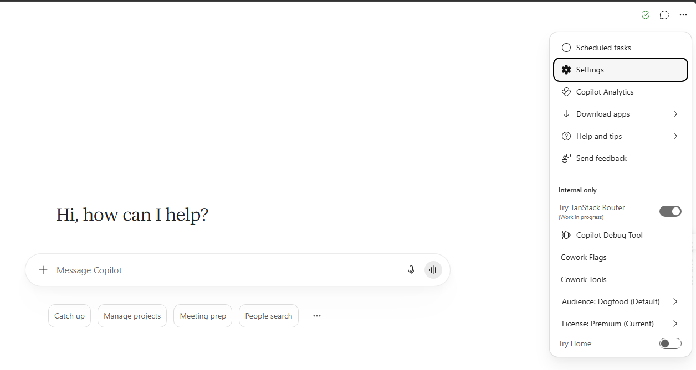
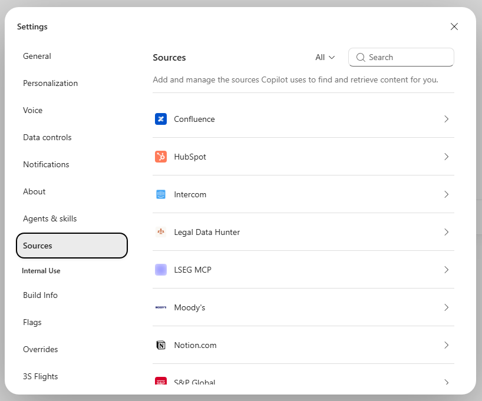
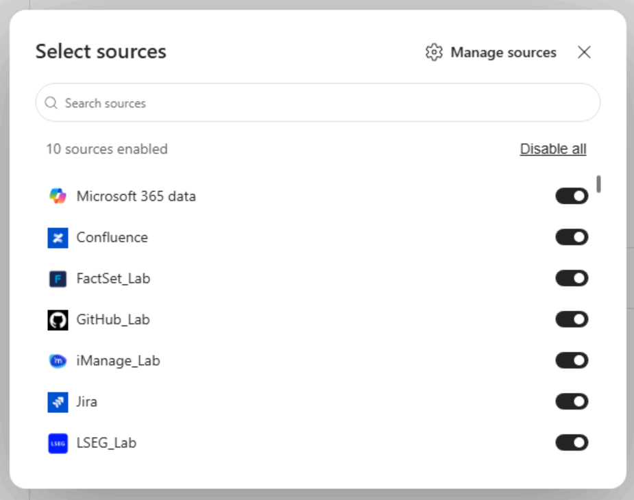
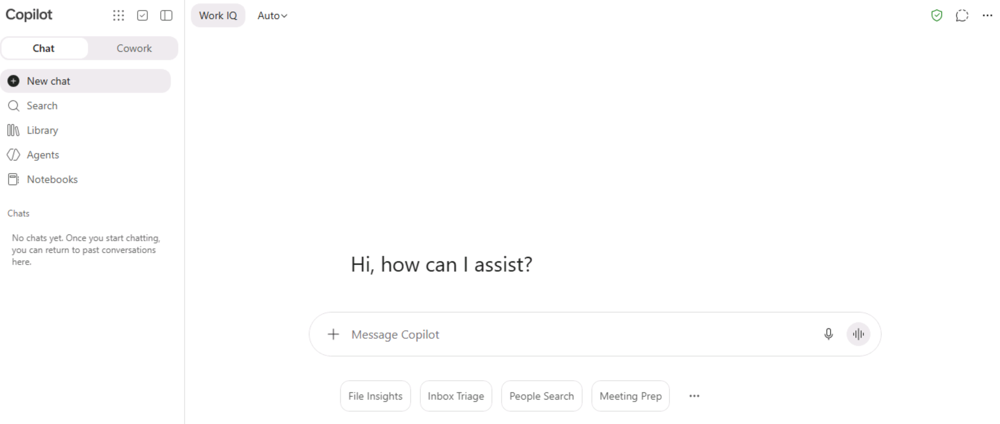
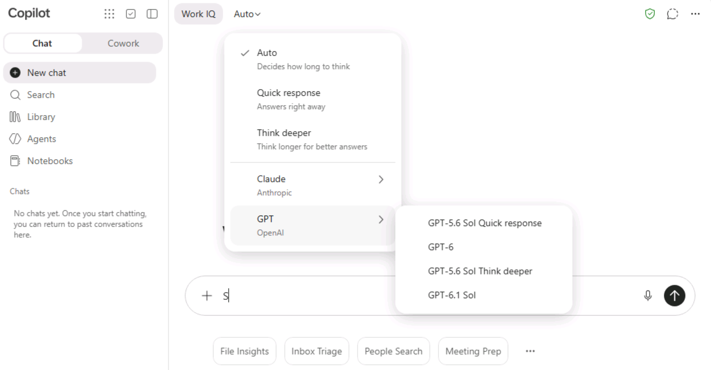

# Getting started with connectors

> **Duration:** ~10 minutes | **Previous:** [Introduction](01-introduction.md) | **Next:** pick a track

## Objective

Sign in as Emil, discover connectors in the catalog, check the ones for your track are ready, and ask your first grounded question.

## Step 1: Sign in

1. Sign in to the lab computer with the credentials on your **seat card**.
2. On the taskbar at the bottom of the screen, select **Microsoft Edge**.
3. In Edge, go to **Microsoft 365 Copilot** at [copilot.cloud.microsoft](https://copilot.cloud.microsoft/) and sign in with the Emil Vanggaard account from your seat card.

> [!TIP]
> If a sign-in popup is blocked at any point in the lab, allow popups for the Copilot site and try again.

## Step 2: Discover connectors

1. In Copilot, select the three dots (**...**) in the top-right corner, then select **Settings**.

   

2. In **Settings**, select **Sources**.

   

3. Browse the catalog. It has more than 300 connectors, from CRM and ticketing to code, wikis and market data.
4. Find the connectors for the track you'll take:

    | Track | Connectors |
    |---|---|
    | Finance | LSEG_Lab · FactSet_Lab · Moodys_Lab |
    | Legal | iManage_Lab |
    | Productivity | Salesforce_Lab |
    | Engineering | Jira · Confluence · GitHub_Lab · Rovo_Lab |
    | Bring your own app (everyone) | Zava Expense: you'll add this one yourself in [module 7](07-custom-mcp.md) |

    Outlook, Teams and your Microsoft 365 files are available in every track.

> [!NOTE]
> All the connectors above are mock versions of the real connectors, built for this lab. They behave like the real ones and come with the same skills, but they serve sample data for the fictional Zava company. You don't need a third-party account to use them. Changes you make with them are visible only in the conversation where you make them.

## Step 3: Check your sources are ready

1. Close **Settings**.
2. In Copilot, select the plus icon (**+**) at the left of the message box, then select **Change data sources**.
3. In **Select sources**, check that **Microsoft 365 data** and the connectors for your track are turned on. They're all on by default.

   

4. If one of your track's connectors is off, turn it on. Then close **Select sources**.

> [!TIP]
> In a real organization, an admin deploys connectors like these once, and people sign in to them with their own accounts. In this lab, that setup has been done for you.

## Step 4: Ask your first grounded question

Each question below needs facts from a system you'd normally open on its own: market data, a document management system, a CRM record or a Jira ticket. Without connectors, you'd search that system and copy the answer across. With connectors, Copilot fetches it for you and cites where it came from.

1. In Copilot, select **Chat** at the top of the left pane, then select **New chat**.

   

2. Enter the question for your track.

   **Finance:**

   ```text
   Using LSEG, what was Litware's earnings per share last quarter compared with the analyst consensus?
   ```

   **Legal:**

   ```text
   Using iManage, what are the hard stops in the Zava AI Procurement Playbook?
   ```

   **Productivity:**

   ```text
   What's the stage and amount of the Lakeshore Retail opportunity in Salesforce?
   ```

   **Engineering:**

   ```text
   What's the status of Jira issue AUR-142?
   ```

**What to look for:** the answer cites its source, such as the connector name, a record, a page or a link.

> [!TIP]
> **Connect once, use everywhere.** These connectors also work in the Copilot experiences in Word, Excel, PowerPoint and Copilot Cowork. You'll see this in the tracks: you don't need to set anything up again.

## Checkpoint

- [ ] You're signed in as Emil.
- [ ] The connectors for your track are turned on in **Select sources**.
- [ ] Your first question came back with a cited source.

## Choose your track

Pick the track closest to your work. Each track takes about 15 to 20 minutes.

| Track | The ask |
|---|---|
| [Finance](03-finance.md) | Kristian, who runs the Zava investment portfolio, asks: should we buy more Litware? Bring a recommendation to Monday's investment committee. |
| [Legal](04-legal.md) | Luc, Chief Underwriting Officer, asks: can we sign Trey Research's AI underwriting contract on the 10th? |
| [Productivity](05-productivity.md) | Pitch the Aurora rollout to all 400 Lakeshore Retail stores, with a CFO in the room and a competitor 20% cheaper. |
| [Engineering](06-engineering.md) | One Sprint 24 item is at risk, and the customer's pilot expands on Monday. Who is it waiting on? |

After your track, everyone goes to [Bring your own app](07-custom-mcp.md).

> [!TIP]
> If Copilot doesn't give the response you expect in any track, select the model name at the top of the chat, switch from **Auto** to a GPT model that isn't a quick-response one, and send the prompt again.
>
> 

---

**Pick a track:** [Finance](03-finance.md) · [Legal](04-legal.md) · [Productivity](05-productivity.md) · [Engineering](06-engineering.md)
