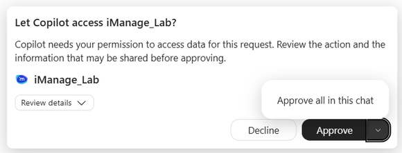

# Legal track: Can we sign on the 10th?

> **Duration:** ~15 minutes | **Connectors:** Work IQ (email and Teams), iManage_Lab | **Surfaces:** Word (Copilot), Copilot Cowork

## The story

Zava, a US car and home insurer, wants **Trey Research's** AI to make up to 4 million underwriting decisions a month: a five-year, **$14.75 million** deal. Regulators in Colorado and New York hold the insurer responsible for vendor AI. Zava trains the AI on its own claims data, so it must own what gets built.

Nothing is signed. Trey Research sent its own one-sided draft, and it's in your OneDrive. Zava's playbook is in the iManage matter. A negotiation session with Trey Research is booked for **Thursday, December 10**.

| Person | Role |
|---|---|
| **Emil Vanggaard** (you) | Associate General Counsel, Technology Transactions. You own this contract. |
| Luc Lacombe | Chief Underwriting Officer. Business owner; wants the AI live on the 13th. |
| Hemanti Baishya | SVP, Strategic Procurement. Emailed you the business's must-haves two weeks ago. |

Luc has pinged you on Teams:

> "Morning Emil. Have you had a chance to look at Trey Research's contract? We'd like to sign at the session with them on the 10th so we can go live on the 13th. Anything you need from me?"

You need the backstory, a redline and a plain-English answer before December 10. You'll use three prompts in one Word chat and one in Cowork, and you'll approve everything.

## What you'll take away

- **Copilot in Word** flags and redlines a contract inside the document, with a reason on every change.
- **Connectors bring the matter to the work:** the backstory from Outlook and Teams, the matter and playbook from iManage. Nothing is uploaded.
- **Cowork legal skills** turn the redline into a negotiation pack, and wait for your approval before anything is sent.

## How the track flows


## Before you start

- [ ] You completed [Getting started with connectors](02-getting-started.md).
- [ ] **iManage_Lab** shows as connected.
- [ ] You can see Luc's message in Teams.
- [ ] Open **Trey Research Vendor Agreement v4.2** in Word from your OneDrive, and open the Copilot pane:
  1. In Copilot or Cowork, select the app launcher (the 3×3 grid of dots) in the top-left corner.
  2. Select **More apps**, then **OneDrive**.
  3. In the left rail, select **My files**, then open the **Trey Research** folder.
  4. Double-click **Trey Research Vendor Agreement v4.2** to open it in Word.
  5. In Word, select the **Copilot** icon in the top-right corner to open the Copilot pane.

The iManage matter [Trey Research – AI Platform Agreement](https://mock-imanage.yellowsand-9530f5dc.eastus.azurecontainerapps.io/work/link/w/Dev!1870) holds the [Zava AI Procurement Playbook v2.1](https://mock-imanage.yellowsand-9530f5dc.eastus.azurecontainerapps.io/work/link/d/DEV!252567.1): Zava's rules for what it will and won't accept in AI contracts. Open it to see what Copilot will read. Its **Drafts** folder is empty until Step 5.

## Step 1: Catch up

*Word · Copilot pane · Work IQ*

With the agreement open, enter:

```text
Catch me up on the Trey Research deal in five bullets: what Hemanti and Luc asked for, what we've decided, and what's still open.
```

**What to look for:**

- Hemanti's ask: Zava must own the fine-tuned model ("we don't go to the table without it").
- Luc's ask: no more abrupt model retirements. The last vendor gave two weeks' notice and Zava couldn't quote for a week.
- What's still open: the draft meets neither ask. Trey Research owns models trained on Zava's data (§9.1), and can change or retire a model on 15 days' notice with no Zava veto (§§7.2–7.5).
- Other gaps Copilot may list: the six-month liability cap, patent-only indemnity, no audit rights, and data returned only in Trey Research's format.
- Each bullet links to Hemanti's email or the Teams chat.

> [!TIP]
> Luc only asked "can we sign?" Copilot pulled the backstory from an older email and a Teams chat, then checked it against the open draft, without you leaving the contract. It may also spot that Hemanti's email assumes flat fees while the draft adds a 5% yearly increase.

## Step 2: Flag the hard stops

*Same Word chat · iManage_Lab*

```text
Which clauses in this agreement break the hard stops in our Zava AI Procurement Playbook in iManage? Add one short comment on each with the playbook section.
```

> [!IMPORTANT]
> When the **Let Copilot access iManage_Lab?** card appears, don't select **Approve** on its own. Select the arrow next to **Approve**, then **Approve all in this chat**. That covers this step and Step 3, so you won't be asked again for each call.
>
> 

**What to look for:**

- Scroll through the agreement as Copilot works. Comments appear on the clauses one by one, each tied to the playbook it's reading from iManage. If Word shows a **Done** bar at the bottom, select it when Copilot finishes.
- Every one of the playbook's six hard stops is flagged: outputs Zava doesn't own, liability with nothing uncapped, capped subcontractor liability, data returned only in Trey Research's format, arbitration in Austin, and a class-action waiver.
- Each short comment names the hard stop the clause breaks and cites the playbook section.
- Select a **Zava AI Procurement Playbook** citation in Copilot's answer to open the playbook in iManage and check the section yourself.

> [!TIP]
> The playbook never left iManage, and nothing was uploaded. Copilot read Zava's rules where they live and applied them to the contract in front of you.

## Step 3: Fix the two must-haves

*Same Word chat · iManage_Lab*

```text
Now redline this so we own the fine-tuned model and get 60 days' notice and our approval before any model change or retirement. Keep the edits minimal, with one short comment on each.
```

**What to look for:**

- Scroll through the agreement as Copilot works. Each change appears as a tracked change with a short comment. If Word shows a **Done** bar at the bottom, select it when Copilot finishes.
- Zava owns the models fine-tuned on its data, including their weights, while Trey Research keeps its base technology (§9.1).
- Trey Research can't change or retire a model without 60 days' notice and Zava's written approval, and continuing to use the platform doesn't count as approval (Section 7).
- The comments from Step 2 are still there.

> [!TIP]
> One business sentence, no section numbers. Copilot found the clauses itself and wrote in the positions. Hemanti's and Luc's must-haves are now contract language.

## Step 4: Build the negotiation pack

*Copilot Cowork (open it from Word) · iManage_Lab · Work IQ*

> [!IMPORTANT]
> In Cowork, select **Customize** and turn on **iManage_Lab**. Then turn off the **Fabric IQ** plugin, which is on by default.

```text
Get me ready for the December 10 session with Trey Research. Make a one-sheet negotiation list with just my redline, the hard-stop flags and the top gaps against what Colorado and New York insurance regulators expect against our playbook in iManage. Then send Luc and Hemanti a 30-minute prep invite for this week with a five-line summary as agenda.
```

**What to look for:**

- A one-page negotiation sheet in your OneDrive with:
  - The six hard stops, each with the playbook section it breaks and no fallback.
  - Your other redline positions. Cowork notes that your model-change redline goes further than the playbook asks, and suggests the fallback.
  - The top gaps against New York's and Colorado's AI rules for insurers, such as no audit rights, no bias testing and no duty to cooperate with regulators, each linked to the regulation.
- In the **Regulatory cooperation** row, compare what regulators expect with the playbook ask.
- A **Create calendar event?** card for a 30-minute prep meeting with Luc and Hemanti, with a five-line agenda.

> [!TIP]
> New York expects AI vendors to cooperate with regulators. Zava's playbook only asks to be told about an inquiry. Cowork put the regulations and the playbook side by side, so you can see that the playbook needs updating, not just the contract.

## Step 5 (optional): File it in the matter

*Same Cowork chat · iManage_Lab*

```text
Save the negotiation list to the Drafts folder of the Trey Research matter in iManage.
```

**What to look for:**

- One **iManage_Lab** approval card. Approve it.
- A link to the saved file. Open it to see the negotiation list in the matter's **Drafts** folder.

> [!TIP]
> Cowork writes back to iManage too, so the work product lands in the matter alongside the playbook.

## If it goes wrong

| What happens | What to do |
|---|---|
| Step 1 doesn't find Hemanti's email or the Teams chat | Ask: "What did Hemanti send me about Trey Research?" then rerun Step 1. |
| Suggestions don't appear as comments or tracked changes | Make sure the agreement is the active document, then rerun the step. |
| Cowork is still working | Carry on. Come back to the review list when it's done. |

## Checkpoint

- [ ] Your catch-up linked to Hemanti's email and the Teams chat.
- [ ] The agreement has comments on the hard stops and a redline for the two must-haves.
- [ ] Cowork produced the negotiation list, one-pager and Teams reply, and you approved the reply.
- [ ] (Optional) The negotiation list is in the matter's Drafts folder.

**What you take away:** Copilot did the reading, the redlining and the drafting across email, Teams and iManage. You stayed the lawyer: every change has a reason, and nothing went out without your approval.

> [!NOTE]
> Fictional parties adapted from the Harvey lab (MIT license). Not legal advice.

## More connectors to try

The same pattern works with other connectors. Try them in your own tenant for similar scenarios.

<table>
  <tr>
    <td align="center"></td>
    <td align="center"></td>
  </tr>
</table>

<sub>Logos are trademarks of their respective owners.</sub>

---

**Next:** [Bring your own app](07-custom-mcp.md), or try another track ([Finance](03-finance.md) · [Productivity](05-productivity.md) · [Engineering](06-engineering.md))
