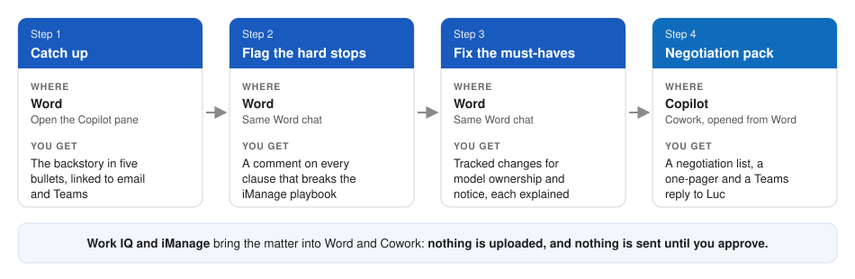

# Legal track: Can we sign on the 10th?

> **Duration:** ~15 minutes | **Connectors:** Work IQ (email and Teams), iManage_Lab | **Surfaces:** Word (Copilot with legal skills), Copilot Cowork

## The story

Zava, a US car and home insurer, wants **Trey Research's** AI to make up to 4 million underwriting decisions a month: a five-year, **$14.75 million** deal. Regulators in Colorado and New York hold the insurer responsible for vendor AI. Zava trains the AI on its own claims data, so it must own what gets built.

Nothing is signed. Trey Research sent its own one-sided draft, and it's in your OneDrive. Zava's playbook is in the iManage matter. A negotiation session with Trey Research is booked for **Thursday, December 10**.

| Person | Role |
|---|---|
| **Emil Vanggaard** (you) | Associate General Counsel, Technology Transactions. You own this contract. |
| Luc Lacombe | Chief Underwriting Officer. Business owner; wants the AI live on the 13th. |
| Hemanti Baishya | SVP, Strategic Procurement. Emailed you the business's must-haves two weeks ago. |

Luc has pinged you on Teams:

> "Morning Emil. Have you had a chance to look at Trey Research's contract? We'd like to sign at the session with them on the 10th so we can go live on the 13th. Anything you need from me?"

You need the backstory, a redline and a plain-English answer before December 10. You'll use three prompts in one Word chat and one in Cowork, and you'll approve everything.

## What you'll take away

- **Word legal skills** flag and redline a contract inside the document, with a reason on every change.
- **Connectors bring the matter to the work:** the backstory from Outlook and Teams, the matter and playbook from iManage. Nothing is uploaded.
- **Cowork legal skills** turn the redline into a negotiation pack, and wait for your approval before anything is sent.

## How the track flows



## Before you start

- [ ] You completed [Getting started with connectors](02-getting-started.md).
- [ ] **iManage_Lab** shows as connected.
- [ ] You can see Luc's message in Teams.
- [ ] Open **Trey Research Vendor Agreement v4.2** in Word from your OneDrive, and open the Copilot pane:
  1. In Copilot or Cowork, select the app launcher (the 3×3 grid of dots) in the top-left corner.
  2. Select **More apps**, then **OneDrive**.
  3. In the left rail, select **My files**, then open the **Trey Research** folder.
  4. Double-click **Trey Research Vendor Agreement v4.2** to open it in Word.
  5. In Word, select the **Copilot** icon in the top-right corner to open the Copilot pane.

The iManage matter [Trey Research – AI Platform Agreement](https://mock-imanage.yellowsand-9530f5dc.eastus.azurecontainerapps.io/work/link/w/Dev!1870) holds the [Zava AI Procurement Playbook v2.1](https://mock-imanage.yellowsand-9530f5dc.eastus.azurecontainerapps.io/work/link/d/DEV!252567.1): Zava's rules for what it will and won't accept in AI contracts. Open it to see what Copilot will read. Its **Drafts** folder is empty until Step 4.

## Step 1: Catch up

*Word · Copilot pane · Work IQ*

With the agreement open, enter:

```text
Catch me up on the Trey Research deal in five bullets: what Hemanti and Luc asked for, what we've decided, and what's still open.
```

**What to look for:**

- Hemanti's ask: Zava must own the fine-tuned model ("we don't go to the table without it").
- Luc's ask: no more abrupt model retirements. The last vendor gave two weeks' notice and Zava couldn't quote for a week.
- What's still open: the draft meets neither ask. Trey Research owns models trained on Zava's data (§9.1), and can change or retire a model on 15 days' notice with no Zava veto (§§7.2–7.5).
- Other gaps Copilot may list: the six-month liability cap, patent-only indemnity, no audit rights, and data returned only in Trey Research's format.
- Each bullet links to Hemanti's email or the Teams chat.

> [!TIP]
> Luc only asked "can we sign?" Copilot pulled the backstory from an older email and a Teams chat, then checked it against the open draft, without you leaving the contract. It may also spot that Hemanti's email assumes flat fees while the draft adds a 5% yearly increase.

## Step 2: Flag the hard stops

*Same Word chat · iManage_Lab · Word legal skills*

```text
Which clauses in this agreement break the hard stops in our AI Procurement Playbook in the Trey Research AI Platform matter in iManage? Add a comment on each one with the playbook section.
```

**What to look for:**

- Eight comment suggestions covering all six hard stops. Select **Apply 8 suggestions**.
- Outputs not owned (§3.2, §9.2), nothing uncapped (§16.2, §16.3), subcontractor liability capped (§14.2), data back only in Trey Research's format (§20.2), arbitration in Austin (§22.2), class-action waiver (§22.4).
- Each comment cites the playbook section and its hard-stop number.

> [!TIP]
> The playbook never left iManage. Say "which clauses break", not "review against the playbook": that phrase starts a different flow that asks you to upload a playbook.

## Step 3: Fix the two must-haves

*Same Word chat · iManage_Lab · edit contract skill*

```text
Now redline this so we own the fine-tuned model, and Trey Research can't change or retire the model without real notice and our approval. Explain each change in a comment.
```

**What to look for:**

- Eight tracked changes, each with a comment. Apply the first two, then **Apply 6 suggestions**.
- Zava owns fine-tuned models, delivered in a portable format (§9.1).
- 60 days' detailed notice and Zava approval before any model change or retirement; continued use isn't acceptance (§§7.2–7.4). Only non-behavioral fixes are exempt.
- Retired versions kept for 12 months, with migration help (§7.5).

> [!TIP]
> One business sentence, no section numbers. Copilot found the clauses itself and wrote in the playbook's positions. Luc's Teams worry is now contract language.

## Step 4: Build the negotiation pack

*Copilot Cowork (open it from Word) · iManage_Lab · Work IQ*

> [!IMPORTANT]
> In Cowork, select **Customize** and turn on **iManage_Lab**. Then turn off the **Fabric IQ** plugin, which is on by default.

```text
Get me ready for the December 10 session with Trey Research. Turn my redline and the flags into a negotiation list with our playbook fallbacks, check whether it covers what Colorado and New York regulators expect, write a one-page summary for Luc and Hemanti, and draft my reply to Luc. Save it all to the matter.
```

**What to look for:**

- A negotiation list with one row per change or flag, the playbook fallback, and "do not concede" on hard stops.
- A regulator check against the Colorado and New York rules: no audit right, no bias testing and no regulator cooperation clause, and the playbook itself has no regulator-cooperation clause.
- A one-pager: "The 10th is a negotiation, not a signing; three asks."
- A reply to Luc, held for your approval. Files are saved to **Drafts** in the matter. Follow the links Copilot returns to see them in iManage.

Open Cowork's review list, check the one-pager (the regulator points link to the published regulations) and approve the reply to Luc.

> [!TIP]
> Cowork keeps working in the background. One request becomes four deliverables across iManage and Outlook, and nothing is sent until you approve it.

## If it goes wrong

| What happens | What to do |
|---|---|
| Step 1 doesn't find Hemanti's email or the Teams chat | Ask: "What did Hemanti send me about Trey Research?" then rerun Step 1. |
| Copilot asks you to upload a playbook | Rephrase with "which clauses break the hard stops in our AI Procurement Playbook in iManage". |
| Suggestions don't appear as comments or tracked changes | Make sure the agreement is the active document, then rerun the step. |
| Cowork is still working | Carry on. Come back to the review list when it's done. |

## Checkpoint

- [ ] Your catch-up linked to Hemanti's email and the Teams chat.
- [ ] The agreement has comments on the hard stops and a redline for the two must-haves.
- [ ] The negotiation list, one-pager and reply are in Drafts, and you approved the reply.

**What you take away:** Copilot did the reading, the redlining and the drafting across email, Teams and iManage. You stayed the lawyer: every change has a reason, and nothing went out without your approval.

> [!NOTE]
> Fictional parties adapted from the Harvey lab (MIT license). Not legal advice.

## More connectors to try

The same pattern works with other connectors. Try them in your own tenant for similar scenarios.

<table>
  <tr>
    <td align="center"></td>
    <td align="center"></td>
  </tr>
</table>

<sub>Logos are trademarks of their respective owners.</sub>

---

**Next:** [Bring your own app](07-custom-mcp.md), or try another track ([Finance](03-finance.md) · [Productivity](05-productivity.md) · [Engineering](06-engineering.md))
