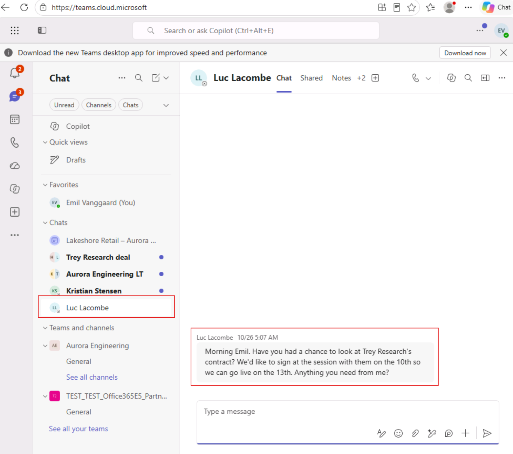
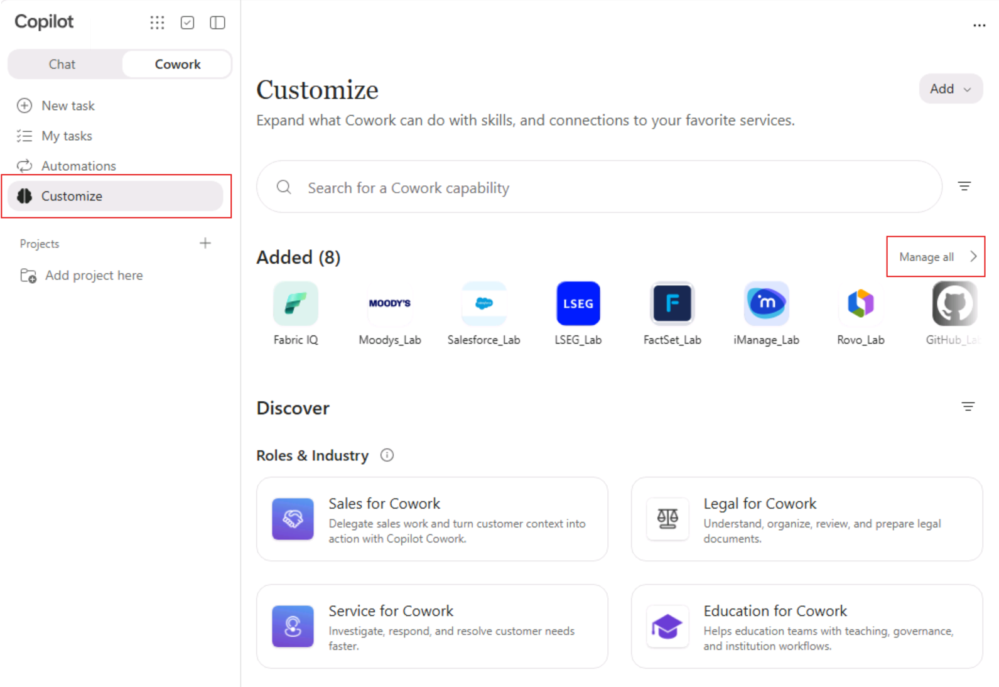
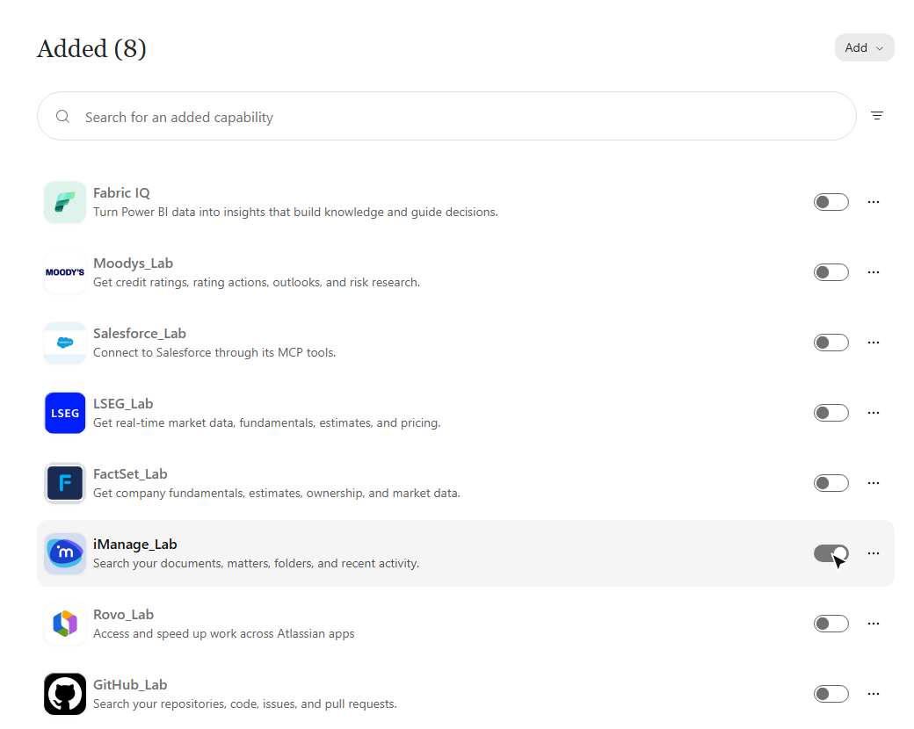
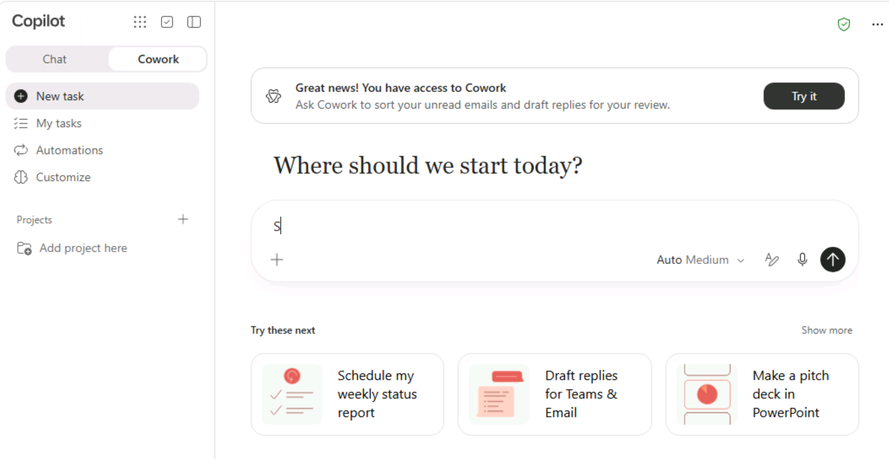
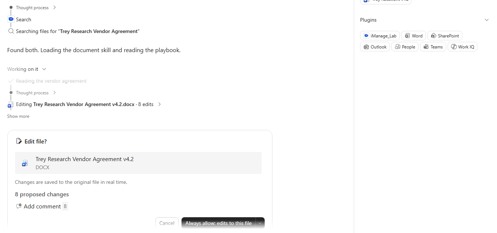
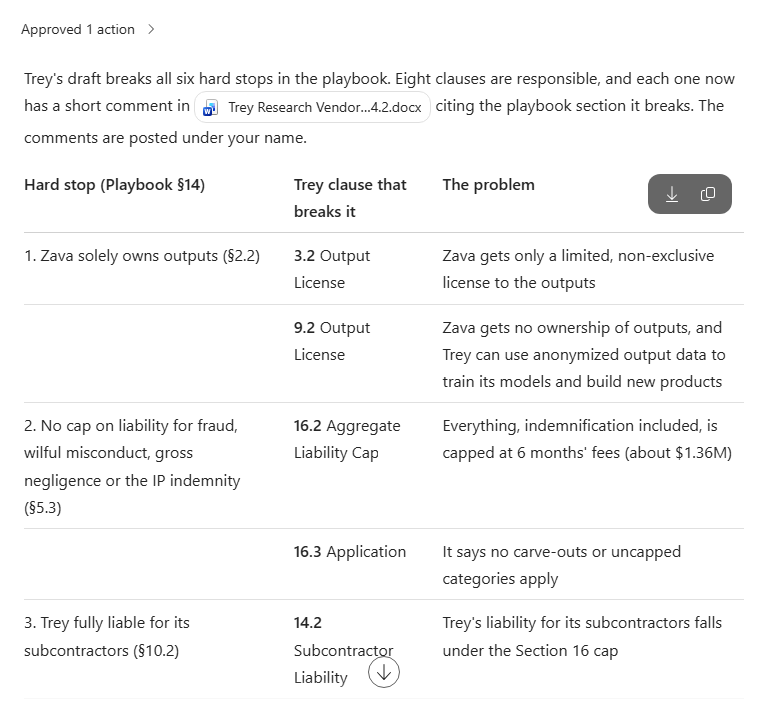
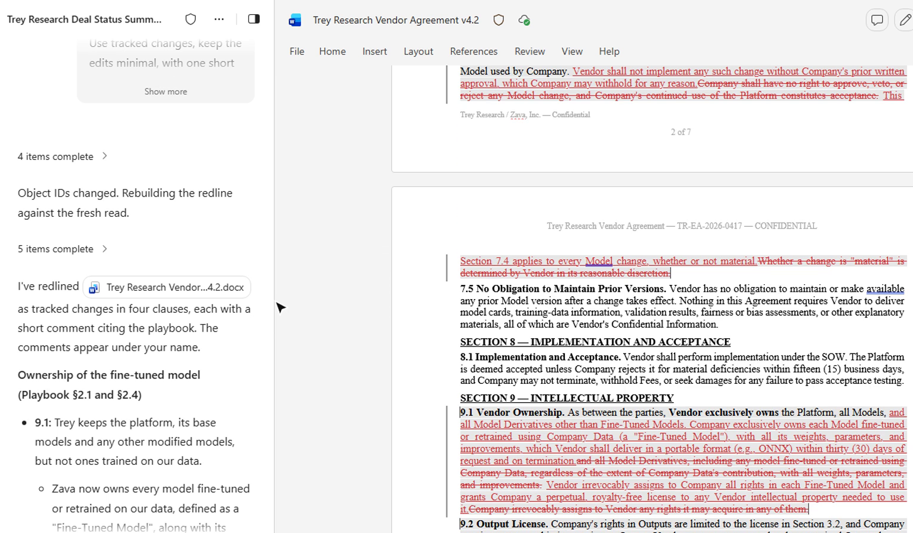
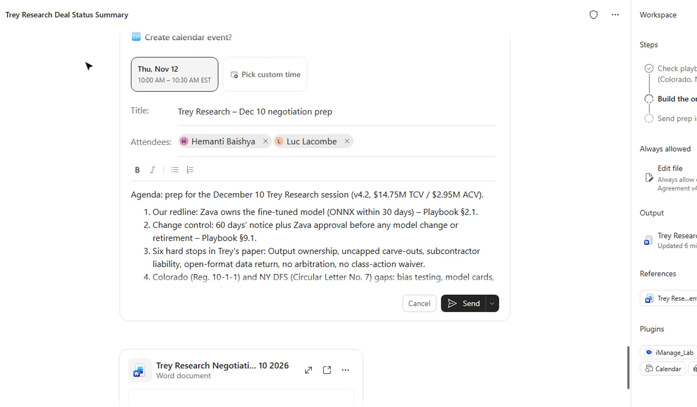
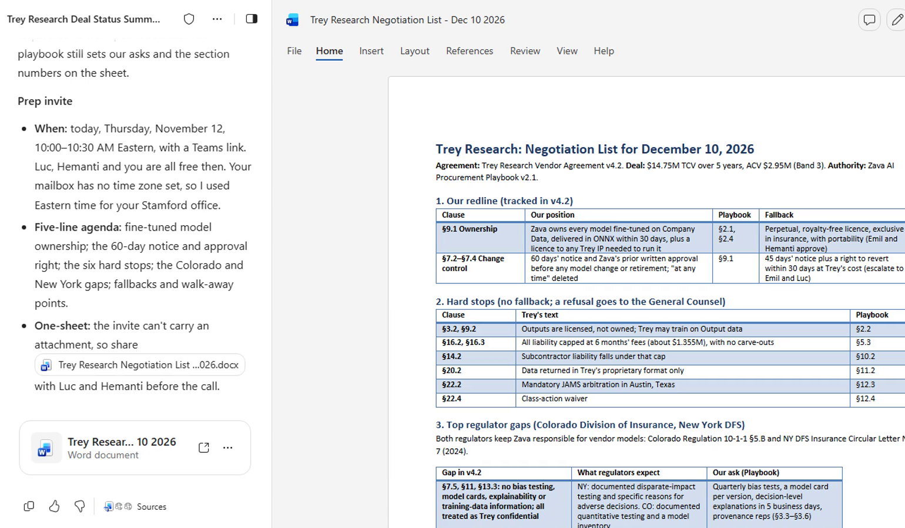

# Legal track: Can we sign on the 10th?

> **Duration:** ~20 minutes | **Connectors:** Work IQ (email and Teams), iManage_Lab | **Surface:** Copilot Cowork

## The story

Zava, a US car and home insurer, wants **Trey Research's** AI to make up to 4 million underwriting decisions a month: a five-year, **$14.75 million** deal. Regulators in Colorado and New York hold the insurer responsible for vendor AI. Zava trains the AI on its own claims data, so it must own what gets built.

Nothing is signed. Trey Research sent its own one-sided draft, and it's in your OneDrive. Zava's playbook is in the iManage matter. A negotiation session with Trey Research is booked for **Thursday, December 10**.

| Person | Role |
|---|---|
| **Emil Vanggaard** (you) | Associate General Counsel, Technology Transactions. You own this contract. |
| Luc Lacombe | Chief Underwriting Officer. Business owner; wants the AI live on the 13th. |
| Hemanti Baishya | SVP, Strategic Procurement. Emailed you the business's must-haves two weeks ago. |

Luc has pinged you on Teams:

> "Morning Emil. Have you had a chance to look at Trey Research's contract? We'd like to sign at the session with them on the 10th so we can go live on the 13th. Anything you need from me?"

You need the backstory, a redline and a plain-English answer before December 10. You'll do it all in one Copilot Cowork task: four prompts, plus an optional fifth. Cowork reads your email and Teams, reads the playbook in iManage, and works on the agreement in your OneDrive. You approve every edit and every invite.

## What you'll take away

- **Copilot Cowork** reviews, comments on and redlines a contract in your OneDrive, with a reason on every change.
- **Connectors bring the matter to the work:** the backstory from Outlook and Teams, the matter and playbook from iManage. Nothing is uploaded.
- **You stay in control:** Cowork turns the redline into a negotiation sheet and a prep invite, checks them against the playbook and the regulators, and asks before it edits a file or sends anything.

## How the track flows


## Before you start

- [ ] You completed [Getting started with connectors](02-getting-started.md).

First, check that Luc's message is waiting for you in Teams. Then you'll set up Cowork.

> [!NOTE]
> iManage is a document management system that law firms and legal teams use to store contracts, playbooks and other matter documents. **iManage_Lab** is the lab version of the iManage connector.

### Read Luc's message in Teams

1. Select **Microsoft Edge** on the taskbar, then go to [teams.cloud.microsoft](https://teams.cloud.microsoft/).
2. In the left rail, select **Chat**.
3. Under **Chats**, select **Luc Lacombe**.
4. Check that you see Luc's message asking whether you've looked at Trey Research's contract and whether you can sign on the 10th.

   

The iManage matter [Trey Research – AI Platform Agreement](https://mock-imanage.yellowsand-9530f5dc.eastus.azurecontainerapps.io/work/link/w/Dev!1870) holds the [Zava AI Procurement Playbook v2.1](https://mock-imanage.yellowsand-9530f5dc.eastus.azurecontainerapps.io/work/link/d/DEV!252567.1): Zava's rules for what it will and won't accept in AI contracts. Open it to see what Cowork will read. Section 14 lists six hard stops, positions Zava never concedes. Its **Drafts** folder is empty until Step 5.

### Set up Copilot Cowork

Cowork uses only the plugins you turn on, so first turn on iManage_Lab.

1. Open a new browser tab and go to [copilot.cloud.microsoft](https://copilot.cloud.microsoft/).
2. Select **Cowork** at the top of the left pane.
3. In the left pane, select **Customize**.
4. Next to **Added**, select **Manage all**.

   

5. Turn on **iManage_Lab**.
6. Turn off **Fabric IQ**, which is on by default. Leave every other plugin off.

   

7. In the left pane, select **New task**.

   

You don't need to turn on Outlook, Teams or Word. Cowork has them built in.

## Step 1: Catch up

*Copilot Cowork · new task · Work IQ (Outlook and Teams)*

In the new task, enter:

```text
Catch me up on the Trey Research deal in five bullets: what Hemanti and Luc asked for, what we've decided, and what's still open.
```

Cowork shows its work as it goes. Select **items complete** above the answer to expand the steps.


**What to look for:**

- The steps show Cowork getting Hemanti's email from **Outlook** and reading the chat in **Teams**.
- What's riding on it: a five-year, $14,750,000 deal for up to 4 million underwriting decisions a month, with the session on December 10.
- Hemanti's ask: Zava must own the fine-tuned model weights. She calls it the #1 business priority.
- Luc's ask: no more abrupt model retirements. The last vendor retired its model on two weeks' notice, and Zava couldn't quote for a week.
- What's been decided: owning the model is a requirement before negotiating ("we don't go to the table without owning the fine-tuned model").
- What's still open: your review of the draft against the playbook, and a prep call with Hemanti and Luc before December 10.
- **Sources** under the answer link to Hemanti's email and the Teams chat.

> [!TIP]
> Luc only asked "can we sign?" Cowork pulled the backstory from an older email and a Teams chat, so you know what the business needs before you open the contract.

## Step 2: Flag the hard stops

*Same Cowork task · iManage_Lab · Word*

In the same task, enter:

```text
Which clauses in the Trey Research Vendor Agreement v4.2 in my OneDrive break the hard stops in our Zava AI Procurement Playbook in iManage? Add one short comment on each in the document, citing the playbook section.
```

Cowork finds the agreement in your OneDrive and reads the playbook through **iManage_Lab**. You'll see **iManage_Lab** listed under **Plugins** in the **Workspace** panel on the right.

Before it changes the document, Cowork shows an **Edit file?** card with the number of proposed changes and comments.

> [!IMPORTANT]
> Select **Always allow: edits to this file**. This covers this step and Step 3, so you won't be asked again for each edit. Changes are saved to the agreement in your OneDrive as they're made.
>
> 

**What to look for:**

- The answer says Trey Research's draft breaks all six hard stops in the playbook, and that each clause now has a short comment in the agreement, posted under your name.
- A table maps each hard stop (Playbook §14) to the clauses that break it:

  | Hard stop | Clauses |
  |---|---|
  | Zava solely owns outputs (§2.2) | 3.2 and 9.2 Output License |
  | No cap on liability for fraud, wilful misconduct, gross negligence or the IP indemnity (§5.3) | 16.2 Aggregate Liability Cap and 16.3 Application |
  | Trey Research fully liable for its subcontractors (§10.2) | 14.2 Subcontractor Liability |
  | No mandatory arbitration (§12.3) | 22.2: JAMS arbitration in Austin |
  | No class-action waiver (§12.4) | 22.4 |
  | Data returned in open formats (§11.2) | 20.2 Data Return |

- Serious gaps that aren't hard stops, including §9.1 (Trey Research owns every fine-tuned model: Hemanti's concern) and §7.4 (15 days' notice of model changes with no Zava approval: Luc's concern).



> [!TIP]
> The playbook never left iManage, and nothing was uploaded. Cowork read Zava's rules where they live and applied them to the contract in your OneDrive.

## Step 3: Fix the two must-haves

*Same Cowork task · iManage_Lab · Word*

In the same task, enter:

```text
Now redline that agreement so we own the fine-tuned model and get 60 days' notice and our approval before any model change or retirement. Use tracked changes, keep the edits minimal, with one short comment on each.
```

This step can take a few minutes while Cowork reads the clauses and makes the edits.

**What to look for:**

- The answer lists the tracked changes, each with a short comment citing the playbook:
  - **§9.1:** Zava owns every model fine-tuned or retrained on its data, with its weights and parameters. Trey Research hands the weights over in a portable format, such as ONNX, and keeps its platform and base models.
  - **§7.4:** the notice period goes from 15 to 60 days, it covers any model change, and Trey Research can't make a change without Zava's prior written approval.
  - **§7.2 and §7.3:** "at any time" is deleted, so neither updates nor retirements can bypass §7.4.
- Related clauses it left alone because you asked for minimal edits, such as §3.4 and §7.5, with a note on why you might clean them up.

Now check the agreement itself:

1. In the answer, select the **Trey Research Vendor Agreement v4.2.docx** link. The agreement opens in Word next to the chat.
2. Scroll to **Section 7** and **Section 9**. Deleted text is struck through and new text is underlined, in red. The comment markers in the right margin hold Cowork's comments from Steps 2 and 3.

   

3. Select **X** in the top-right corner of the agreement to close it and go back to the chat.

> [!TIP]
> One business sentence, no section numbers. Cowork found the clauses itself and wrote in the positions. Hemanti's and Luc's must-haves are now contract language.

## Step 4: Build the negotiation pack

*Same Cowork task · iManage_Lab · Work IQ (Calendar)*

In the same task, enter:

```text
Get me ready for the December 10 session with Trey Research. Make a one-sheet negotiation list with just my redline, the hard-stop flags and the top gaps against what Colorado and New York insurance regulators expect against our playbook in iManage. Then send Luc and Hemanti a 30-minute prep invite for this week with a five-line summary as agenda.
```

The **Steps** list in the **Workspace** panel shows the plan: check the playbook and regulator expectations (Colorado, New York), build the one-sheet negotiation list, and send the prep invite.

When the sheet is ready, Cowork shows a **Create calendar event?** card. Nothing is sent until you select **Send**.

1. Check the date and time. To change them, select **Pick custom time**.
2. Check that **Attendees** shows **Hemanti Baishya** and **Luc Lacombe**, and that the agenda has five lines: your redline, change control, the six hard stops, the Colorado and New York gaps, and fallbacks and walk-away points.
3. Select **Send**.

   

**What to look for:**

- A Word document named **Trey Research Negotiation List** under **Output** in the **Workspace** panel, saved to your OneDrive. Select it to open it next to the chat.
- **1. Our redline:** your two positions, each with the playbook section and a fallback.
- **2. Hard stops:** the six clauses with Trey Research's text and the playbook section. No fallback: a refusal goes to the General Counsel.
- **3. Top regulator gaps (Colorado Division of Insurance, New York DFS):** each gap in the draft, what regulators expect, and Zava's ask from the playbook, such as bias testing, model documentation, audit rights and regulator inquiries.
- A short summary of the invite. The invite can't carry an attachment, so Cowork suggests sharing the sheet with Luc and Hemanti before the call.



> [!TIP]
> Compare **What regulators expect** with **Our ask (Playbook)** in the regulator gaps. Where the regulators expect more than the playbook asks, the playbook needs updating, not just the contract.

## Step 5 (optional): File it in the matter

*Same Cowork task · iManage_Lab*

```text
Save the negotiation sheet to the Drafts folder of the Trey Research matter in iManage.
```

**What to look for:**

- One **iManage_Lab** approval card. Approve it.
- A link to the saved file. Open it to see the negotiation sheet in the matter's **Drafts** folder.

> [!TIP]
> Cowork writes back to iManage too, so the work product lands in the matter alongside the playbook.

## If it goes wrong

| What happens | Try this |
|---|---|
| Step 1 doesn't find Hemanti's email or the Teams chat | Ask: "What did Hemanti send me about Trey Research?" then rerun Step 1. |
| Cowork says it can't find the playbook | Select **Customize**, check that **iManage_Lab** is on, then rerun the step. |
| Cowork asks for permission to use iManage_Lab | Approve it. |
| Cowork can't find the agreement | Check that **Trey Research Vendor Agreement v4.2** is in the **Trey Research** folder of your OneDrive, then rerun the step. |
| You don't see the comments or tracked changes | Close the agreement and open it again from the link in Cowork's answer. |
| Cowork asks to approve each edit in Step 3 | Select **Always allow: edits to this file** on the next **Edit file?** card. |

## Checkpoint

- [ ] Your catch-up came from Hemanti's email and the Teams chat.
- [ ] The agreement has comments on the hard stops and a redline for the two must-haves.
- [ ] Cowork produced a one-page negotiation sheet and a prep invite for Luc and Hemanti.
- [ ] (Optional) The negotiation sheet is in the matter's Drafts folder.

**What you take away:** Cowork did the reading, the redlining and the drafting across email, Teams and iManage. You stayed the lawyer: every change has a reason, and nothing went out without your approval.

> [!NOTE]
> Fictional parties adapted from the Harvey lab (MIT license). Not legal advice.

## More connectors to try

The same pattern works with other connectors. Try them in your own tenant for similar scenarios.

<table>
  <tr>
    <td align="center"></td>
    <td align="center"></td>
  </tr>
</table>

<sub>Logos are trademarks of their respective owners.</sub>

## Try it in Word

Want to flag and redline the agreement from the Copilot pane in Word instead? Follow the [Word version of this track](04-legal-word.md).

---

**Next:** [Bring your own app](07-custom-mcp.md), or try another track ([Finance](03-finance.md) · [Productivity](05-productivity.md) · [Engineering](06-engineering.md))
