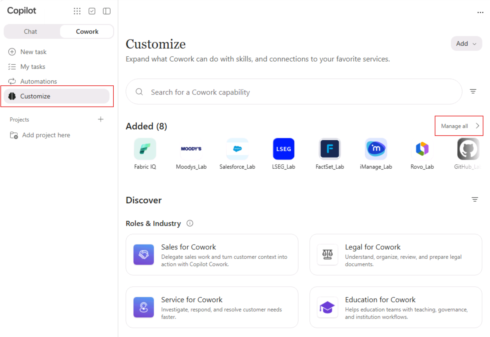
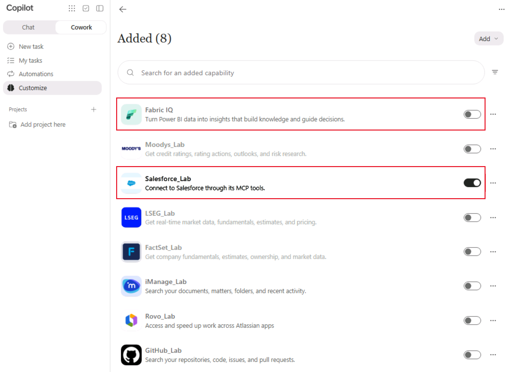
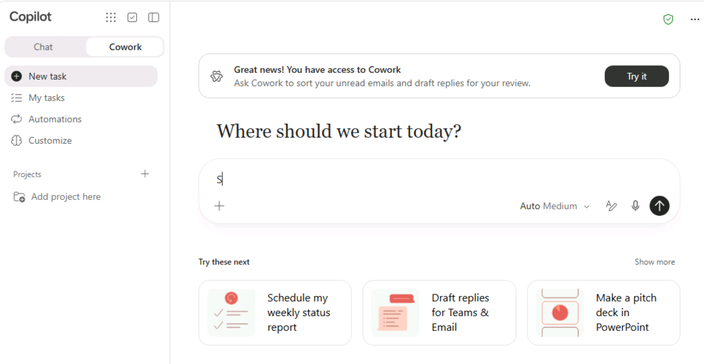

# Productivity track: Sales pitch prep

> **Duration:** ~10 minutes (+ stretch) | **Connectors:** Salesforce_Lab, Teams, Outlook | **Surface:** Copilot Cowork

## The story

You're **Emil Vanggaard** at Zava, and you own the **Lakeshore Retail** account. Lakeshore Retail has piloted the **Aurora** smart-home hub in 50 stores for six weeks, ahead of the public launch event on Dec 8. Your next step is the **expansion pitch** to roll it out to all 400 stores.

- Atul Manohar, Lakeshore Retail's Director of Store Operations, emailed ahead of the pitch. Their CFO, **Nanami Nakayama**, is joining and wants the all-in cost for 400 stores. Lakeshore Retail IT (**Jahidi Juma**) wants Zava's security documentation before anything goes to 400 stores.
- On the Teams pilot review call, Atul said a competitor, Boulder Innovations, quoted about 20% under your list price.

You'll prep the call, handle the price objection and book the security review, without leaving Copilot.

## What you'll take away

- **A skill that knows how sales teams work:** Salesforce's call-prep skill builds a brief from your real account data.
- **Grounded answers, not guesses:** Copilot quotes what the customer said and uses your own win/loss history to shape the response.
- **From answer to action:** one prompt books a meeting and logs it in your CRM, with your yes before each change.

## How the track flows


## Before you start

- [ ] You completed [Getting started with connectors](02-getting-started.md).

First, check that Atul's email is waiting for you in Outlook. Then you'll set up Cowork.

> [!NOTE]
> Salesforce is a customer relationship management (CRM) system that sales teams use to track accounts, contacts and deals. **Salesforce_Lab** is the lab version of the Salesforce connector.

### Read Atul's email in Outlook

1. Select **Microsoft Edge** on the taskbar, then go to [outlook.cloud.microsoft](https://outlook.cloud.microsoft/).
2. In the search box at the top, enter `Aurora expansion pitch` and press Enter.
3. Open the email from **Atul Manohar** titled *Aurora expansion pitch – Nanami joining, security docs*.
4. Check that it says Nanami, Lakeshore Retail's CFO, wants the all-in cost for 400 stores, and that Jahidi in IT wants Zava's security documentation first.

   

To see what Copilot will read, open the [Lakeshore Retail account](https://mock-salesforce.yellowsand-9530f5dc.eastus.azurecontainerapps.io/lightning/r/Account/001Hp0000000001IAA/view) in Salesforce_Lab.

### Set up Copilot Cowork

Cowork uses only the plugins you turn on, so first turn on Salesforce_Lab.

1. Open a new browser tab and go to [copilot.cloud.microsoft](https://copilot.cloud.microsoft/).
2. Select **Cowork** at the top of the left pane.
3. In the left pane, select **Customize**.
4. Next to **Added**, select **Manage all**.

   

5. Turn on **Salesforce_Lab**.
6. Turn off **Fabric IQ**, which is on by default. Leave every other plugin off.

   

7. In the left pane, select **New task**. Run every step in this one task: Step 3 reuses what Copilot learned in Steps 1 and 2, and your Salesforce changes are kept only within this task.

   

You don't need to turn on Outlook or Teams. Cowork has them built in.

## Step 1: Prep the call

*Copilot Cowork · Salesforce_Lab call-prep skill · Outlook*

In the Cowork task, enter:

```text
Use Salesforce to prep me for my Lakeshore Retail expansion pitch.
```

**What to look for:**

- The meeting: *Lakeshore Retail – Aurora expansion pitch* on Friday, November 20.
- The deal: the [*Lakeshore Retail – Aurora 400-store rollout*](https://mock-salesforce.yellowsand-9530f5dc.eastus.azurecontainerapps.io/lightning/r/Opportunity/006Hp0000000001IAA/view) opportunity, Proposal/Price Quote, $1,200,000, closing Dec 31. Next step: bring the all-in per-store and total cost.
- Who's in the room: Atul (champion), Jahidi (IT security; wants the security docs first) and Nanami (CFO; wants the all-in cost). Nanami isn't a Salesforce contact yet, so Copilot flags her as new.
- What to cover: the price comparison, the security review and next steps.

The layout can vary between runs. The content is what matters.

> [!TIP]
> One prompt turned the CRM and your inbox into a brief that already points to the pitch's two risks: the CFO's cost question and IT's security review.

## Step 2: Handle the price objection

*Same Cowork task · Teams meeting transcript · Salesforce_Lab win/loss history*

In the same task, enter:

```text
Lakeshore Retail says Boulder Innovations is 20% cheaper. How should I handle that? Use what they said on the pilot review call and our win/loss history against Boulder Innovations.
```

**What to look for:**

- From the Oct 22 pilot review transcript in Teams:
  - Atul on the Boulder Innovations quote ("about 20% under your list price", about $2,400 per store) and "sign this quarter".
  - Your breakdown of Boulder's offer: the $2,400 is the hub only, and it lands around $3,250 per store all-in once install and support are added.
  - Your counter-offer: hold the discount to 12% ($2,640 per store against the $3,000 list) and bundle install at no extra cost.
  - Atul on Nanami wanting the all-in cost, and Jahidi on the security review before the 400-store rollout.
- The win in Salesforce: [*Wide World Importers – Aurora 320-store rollout*](https://mock-salesforce.yellowsand-9530f5dc.eastus.azurecontainerapps.io/lightning/r/Opportunity/006Hp0000000003IAA/view), Closed Won, $844,800 against Boulder Innovations, won on all-in TCO rather than sticker price.
- The loss: [*Tailspin Toys – Aurora 120-store rollout*](https://mock-salesforce.yellowsand-9530f5dc.eastus.azurecontainerapps.io/lightning/r/Opportunity/006Hp0000000004IAA/view), Closed Lost on price: "We led with a discount and never showed the all-in TCO."
- The recommendation: **don't match the 20%**. Lead with the all-in cost for 400 stores, and offer 12% plus bundled install. That's the number Nanami asked for.

> [!TIP]
> Copilot combined two sources for one answer. The numbers came from the Teams meeting, and the proof that the approach works came from Salesforce, where Zava beat the same competitor on all-in cost and lost to it when it led with a discount.

## Step 3: Book the security review and log it

*Same Cowork task · Salesforce_Lab schedule-meeting skill · Outlook calendar · write actions*

In the same task, enter:

```text
Send Jahidi and Atul a calendar invite for a 45-minute Aurora security review next week, and log it on the Lakeshore Retail opportunity.
```

**What to look for:**

1. Copilot finds Jahidi and Atul and the open opportunity in Salesforce, checks your calendar and proposes two or three free slots next week (for example, Monday 11:30–12:15 ET).
2. **First confirmation:** a preview of the invite, with an agenda built from Steps 1 and 2. Approve it, and Copilot creates the Outlook invite.
3. **Second confirmation:** a preview of the Salesforce activity. Approve it, and Copilot logs it on the opportunity as a meeting task.
4. A confirmation with a link to the Salesforce record. The record page shows the changes from your conversation.

"Next week" follows today's date, so the proposed slots depend on when you run the lab.

> [!TIP]
> One prompt booked the meeting and updated the CRM, and nothing changed until you said yes.

## Stretch: Log the pilot review call

*Same Cowork task · Salesforce_Lab log-activity skill · write action*

In the same task, enter:

```text
Log the pilot review call on the Lakeshore Retail opportunity.
```

After one confirmation, Copilot logs a completed meeting task dated Oct 22 on the opportunity, with the attendees and key points from the transcript. Open the opportunity's **Activity** tab to see it.

If Copilot can't find the transcript, it asks whether to log the basics now or wait for notes. It marks anything it doesn't know as "[not recorded – add notes]" rather than making it up.

Prefer not to make changes? Try `Draft an email to Atul and Nanami ahead of the pitch to confirm the agenda.` It stays an Outlook draft.

## If it goes wrong

| What happens | What to do |
|---|---|
| Copilot asks which account or meeting | Reply: "The Lakeshore Retail expansion pitch." |
| The brief doesn't mention Nanami | Ask: "Who's on the call, and what does each of them care about?" |
| Step 2 answers from general knowledge | Reply: "Use the Teams transcript of the Lakeshore Retail pilot review and our closed deals against Boulder Innovations in Salesforce." |
| Slot picking runs long | Reply: "The first slot." |
| Copilot asks whether to email or invite | Reply: "Send the invite." |

## Checkpoint

- [ ] Your call brief covers the deal, all three attendees and the two risks.
- [ ] Copilot didn't match the 20% and proposed 12% plus bundled install, led by the all-in cost.
- [ ] The security review is on your calendar and logged on the Lakeshore Retail opportunity.

**What you take away:** Copilot moved from finding information to finishing the job: a brief, a grounded answer, a booked meeting and an updated CRM, with you approving each change.

## More connectors to try

The same pattern works with other connectors. Try them in your own tenant for similar scenarios.

<table>
  <tr>
    <td align="center"></td>
    <td align="center"></td>
    <td align="center"></td>
  </tr>
</table>

<sub>Logos are trademarks of their respective owners.</sub>

---

**Next:** [Bring your own app](07-custom-mcp.md), or try another track ([Finance](03-finance.md) · [Legal](04-legal.md) · [Engineering](06-engineering.md))
