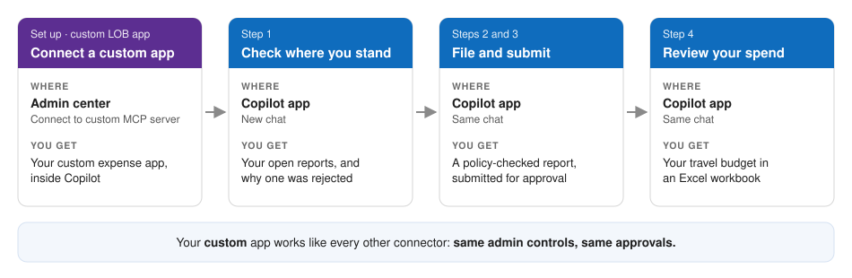

# Bring your own app: Zava Expense

> **Duration:** ~20 minutes | **Connectors:** Zava Expense (custom MCP connector), Outlook | **Surfaces:** Microsoft 365 admin center, Copilot Chat, Excel

In this module, you'll connect **Zava Expense**, your organization's in-house line-of-business app for expenses, as a custom connector with no code, then use it from Copilot to file a trip, from receipts in your inbox to a submitted report.

## The story

You're an AI admin at Zava. Like everyone else, you file travel expenses in Zava Expense, a separate in-house portal you have to leave your work to use. You want everyone in your organization to file expenses where they already work: in Copilot.

You're also just back from a client trip to Seattle for the Fabrikam, Inc. partnership review, and Zava Expense has emailed a reminder: submit your expenses by Friday, November 20. Your receipts are scattered across your inbox, and your last report was rejected for a missing receipt. So you'll connect Zava Expense to Copilot, then file this trip there and get it right the first time.

## What you'll take away

- **Connect your own app, with no code.** Add its MCP server in the admin center, next to the catalog connectors and under the same admin controls.
- **Finish a real job end to end.** Go from receipts in your inbox to a checked, fixed and submitted report, without opening the expense app.
- **Your company's rules, built in.** Every report is checked against the travel policy before it's submitted.

## How the track flows



## Before you start

- [ ] You finished one of the tracks: [Finance](03-finance.md), [Legal](04-legal.md), [Productivity](05-productivity.md) or [Engineering](06-engineering.md).
- [ ] You can open the **Microsoft 365 admin center**. Lab seats have admin rights.

## Set up Zava Expense

> **Where:** Microsoft 365 admin center. There are no prompts in this part.

Zava Expense is a custom line-of-business app, so it isn't in the connector catalog. Your organization's app team has already made it available through a custom MCP server (a standard way for AI tools to talk to an app), so you only need to connect it.

1. Go to **Copilot › Connectors**.
2. On the **Gallery** tab, under **Created by your org**, select **Create a new connector**, then **Connect to MCP server**.
3. Fill in the form:

   | Field | Enter |
   |---|---|
   | Display name | `Zava Expense` |
   | Description | `Zava's in-house expense app. Use it to see the signed-in employee's expense reports and why any were rejected or returned, find corporate card charges for a trip, create a report from receipts, check it against the Zava travel policy, submit it for manager approval, and compare travel spend with budget.` |
   | Base URL | `https://mock-zava-expense.yellowsand-9530f5dc.eastus.azurecontainerapps.io/mcp` |
   | Developer name | `Zava` |
   | Website URL | `https://contoso.com` |
   | Privacy URL | `https://contoso.com/privacy` |
   | Terms of use URL | `https://contoso.com/terms` |
   | Authentication | **No Auth** |

   (This lab uses **No Auth** so you can connect quickly. In your own tenant, choose the authentication your app needs, such as **Microsoft Entra SSO** or **OAuth 2.0**.)

   > [!TIP]
   > Copilot reads the description to decide when to use Zava Expense and what to ask it. A good description says, in plain words, what data the app holds and what it can do.

4. Select **Save**.
5. Under **Staged rollout**, make Zava Expense available to yourself. It now appears under **Your connections**, next to the catalog connectors. Changes can take up to 10 minutes.
6. In Microsoft 365 Copilot in the browser, open **… › Settings › Sources** and connect **Zava Expense**.

## Step 1: Check where you stand

> **Where:** Copilot app. Start a new chat and run Steps 1 to 4 in it. Each new chat starts from the original data.

```text
Using Zava Expense, show me my open expense reports. Were any of them rejected or sent back, and why?
```

**What to look for:** your live reports, straight from Zava Expense:

- Four open reports.
- **ER-1044** (Dallas) was rejected: the $142.60 Pappas Bros receipt is missing.
- **ER-1046** was returned: it has no business purpose.
- **ER-1045** (Austin, $631.50) and **ER-1051** (October local expenses, $953.09) are pending approval.

> [!TIP]
> If Copilot doesn't give the response you expect, select the model name at the top of the chat, switch from **Auto** to a GPT model that isn't a quick-response one, and send the prompt again.

## Step 2: File the trip

> **Where:** Copilot app, in the same chat. Copilot reads your Outlook inbox and writes to Zava Expense.

```text
Find the receipts from my Seattle trip in my inbox and use them to create a Zava Expense report for the Fabrikam, Inc. partnership review. Check the report against our travel policy, but don't submit it yet.
```

**What to look for:**

- Draft report **ER-2001** in Zava Expense: six items totalling **$2,052.65**, with every receipt from your inbox attached.
- **Blocking:** the Westin charged $389 for the night of Oct 28, which is $139 over the $250 Seattle cap.
- **Warning:** the $52.30 Uber ride was charged twice (TX-10111). Copilot suggests asking Ebere Ibeabuchi in Finance Operations to reverse it.

## Step 3: Fix and submit

> **Where:** Copilot app, in the same chat. This step submits the report, so Copilot asks for your approval first.

```text
Add a justification for the $389 Westin night: a city-wide convention pushed up hotel rates, and no hotel near the Fabrikam, Inc. office was under the cap. Then submit the report to my manager.
```

**What to look for:**

- Copilot reruns the check: no blocking issues and one justified exception.
- An approval card appears. Approve it.
- Copilot confirms that ER-2001 ($2,052.65) was submitted to **Hannes Niemi**.

Then check the status:

```text
Has my Seattle report gone through? Who's approving it?
```

ER-2001 is pending approval, and Hannes Niemi is the approver.

## Step 4: Review your spend

> **Where:** Copilot app, in the same chat. Copilot creates the Excel workbook for you.

```text
How am I doing against my Q4 travel budget? Put it in an Excel workbook with a chart.
```

**What to look for:**

- You've spent **$4,309.55 of $6,800** (63%), with about half the quarter gone.
- Over budget on meals and entertainment (106%) and ground transport (111%); lodging is at 80%.
- An Excel workbook with a chart, built from Zava Expense data.

## If it goes wrong

| What happens | What to do |
|---|---|
| Zava Expense doesn't appear in Sources | Check that staged rollout includes you, wait a few minutes, then refresh Copilot. |
| Copilot doesn't use Zava Expense | Start the prompt with "Using Zava Expense". |
| Copilot doesn't give the response you expect | Select the model name at the top of the chat, switch from **Auto** to a GPT model that isn't a quick-response one, and send the prompt again. |
| Copilot says Zava Expense isn't responding | Wait 15 seconds, then send the same prompt again in the same chat. |
| Step 2 misses some receipts | Ask: "Find all my Seattle receipts from October in my inbox." |

## Checkpoint

- [ ] Zava Expense is connected and shows in your sources.
- [ ] ER-2001 was checked against policy, justified and submitted after your approval.
- [ ] You have an Excel summary of your Q4 travel spend.

## Key takeaways

- **Bring your in-house apps into Copilot.** If an app is available through an MCP server, you can connect it in minutes, with no code.
- **Real work, not just answers.** Copilot read your inbox, built the report, fixed the policy issue and submitted it, and asked before submitting.
- **Governed like every other connector.** Admins choose who gets it, and staged rollout lets you test it before everyone sees it.

---

**Next:** [Summary](08-summary.md)
